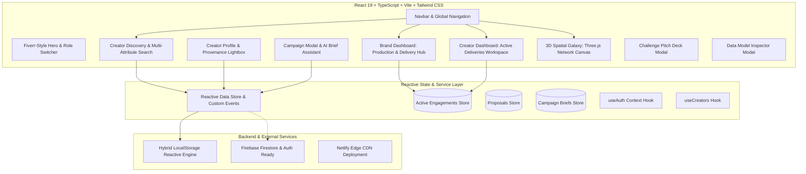

# Creovate AI — AI Content Creator Marketplace 🚀

[](https://6ace49f75f3221a932831ca8--creovate-ai-marketplace.netlify.app)
[](https://react.dev)
[](https://www.typescriptlang.org)
[](https://tailwindcss.com)
[](https://vitejs.dev)
[](https://opensource.org/licenses/MIT)

> **The Premier AI-Native Marketplace Connecting Elite Generative Creators with Commercial Brands & Agencies.**

---

## 🌐 Live Application & Demo Links

- **🚀 Live Application (Netlify)**: [https://6ace49f75f3221a932831ca8--creovate-ai-marketplace.netlify.app](https://6ace49f75f3221a932831ca8--creovate-ai-marketplace.netlify.app)
- **📊 Interactive Data Model Spec**: [`DATA_MODEL.md`](./DATA_MODEL.md) *(also inspectable via the "Data Model" button in the app header)*
- **📑 5-Slide Challenge Presentation**: [`APPROACH_PRESENTATION.md`](./APPROACH_PRESENTATION.md) *(also viewable via the "Demo Slides" button in the app header)*
- **🛠️ Netlify Project Dashboard**: [https://app.netlify.com/projects/creovate-ai-marketplace](https://app.netlify.com/projects/creovate-ai-marketplace)

---

## 📖 Executive Summary & Challenge Brief Alignment

Generative AI tools (*Midjourney, Runway Gen-3, Stable Diffusion, ComfyUI, Kling AI, ElevenLabs*) have created a whole new category of creative professionals—AI filmmakers, prompt directors, virtual avatar animators, and generative visual engineers. However, traditional freelance marketplaces (*Upwork, Fiverr*) are **not designed around AI-native creative workflows**. Brands struggle to verify creator capabilities, inspect model parameters, ensure commercial safety, and collaborate through multi-pass revisions.

**Creovate AI solves this by delivering an end-to-end AI-native platform designed around the full challenge specification:**

| Evaluation Criteria | Implementation in Creovate AI |
| :--- | :--- |
| **Creator Profiles & AI Portfolios** | Full-fidelity creator profiles with verified AI tool stacks, reproducible multi-pass LoRA pipelines, and full **Prompt & Seed Provenance Lightboxes** showing prompts, seeds, samplers, model checkpoints, and IP buyout status. |
| **Brief Definition & Scoping** | Structured brief builder capturing content type, visual style, aspect ratios (`9:16`, `16:9`, `1:1`, `4:5`), commercial licensing terms, preferred AI toolchains, and budget in **Indian Rupees (₹ INR)**. |
| **Creator Search & Filtering** | Multi-attribute, tokenized semantic search across all creator metadata, filters by tool, skill, format, and trust signals, with **sensible empty-state handling** offering contextual 1-click fallback queries. |
| **Discovery-Through-Delivery Lifecycle** | Dual dashboards (Brand Studio & Creator Studio) managing the entire engagement: Brief Published ➔ Proposals ➔ Active Engagement ➔ Multi-Round Generation Drafts with audit logs ➔ Revision Feedback Loop ➔ Milestone Approvals ➔ **Cryptographic Commercial License Certificate**. |
| **Presentation & Deliverables** | Complete data model specification ([`DATA_MODEL.md`](./DATA_MODEL.md)), 5-slide challenge pitch deck ([`APPROACH_PRESENTATION.md`](./APPROACH_PRESENTATION.md)), and interactive in-app modal inspectors. |
| **Bonus Features** | **Creator Verification Signals** (Verified Tools, Workflows, Past Work trust badges + benchmark runner) and **AI-Assisted Brief Builder** (converts rough concepts into structured briefs in 1 click). |

---

## 🏛️ System Architecture



---

## 📂 Project Directory Structure

Below is the directory map of the codebase:

```
new-folder--6/
├── .gitignore                   # Ignored files (node_modules, dist, .env, logs)
├── .env.example                 # Environment variables blueprint
├── .oxlintrc.json               # Fast linter configuration (0 errors, 0 warnings)
├── APPROACH_PRESENTATION.md     # 5-Slide presentation deck specification
├── DATA_MODEL.md                # Comprehensive data schema specification
├── FIREBASE_SETUP.md            # Firebase setup instructions for live DB mode
├── README.md                    # Project documentation, live links & architecture
├── firestore.rules              # Cloud Firestore security rules
├── index.html                   # HTML entry point with meta tags & Google fonts
├── netlify.toml                 # Netlify build and SPA redirect configuration
├── package.json                 # Dependencies and script definitions
├── postcss.config.js            # PostCSS configuration for Tailwind
├── tailwind.config.ts           # Midnight theme, palette tokens, animations
├── tsconfig.json                # Project root TypeScript configuration
├── tsconfig.app.json            # Application TypeScript configuration (strict mode)
├── tsconfig.node.json           # Vite node configuration
├── vite.config.ts               # Vite bundler configuration
│
├── public/                      # Static assets & favicon
│   └── favicon.svg              # Creovate AI brand favicon
│
└── src/                         # Application source code
    ├── components/              # Modular UI components
    │   ├── campaigns/           # Campaign and creative brief components
    │   │   ├── CampaignCard.tsx        # Campaign brief card with format badges
    │   │   ├── CampaignFormModal.tsx   # Structured brief builder & AI Assistant
    │   │   └── InviteCreatorModal.tsx  # Direct creator project invitation modal
    │   ├── creators/            # Creator showcase components
    │   │   ├── CreatorCard.tsx         # Creator card with verification badges
    │   │   ├── CreatorGrid.tsx         # Responsive grid layout with empty states
    │   │   └── PortfolioModal.tsx      # Provenance Lightbox with prompt & seed audit
    │   ├── dashboard/           # Dashboard subcomponents
    │   │   ├── ActiveProposalsTab.tsx  # Proposal inspection with tool stack & quotes
    │   │   └── MetricsGrid.tsx         # Analytics and metric overview cards
    │   ├── galaxy/              # 3D interactive Three.js components
    │   │   ├── GalaxyCanvas.tsx        # WebGL 3D spatial orbit visualization
    │   │   └── ConstellationGrid.tsx   # 2D responsive fallback grid view
    │   ├── layout/              # Structural layout components
    │   │   ├── Navbar.tsx              # Navigation bar with search & slide triggers
    │   │   └── Footer.tsx              # Platform footer with licensing details
    │   └── ui/                  # Reusable atomic UI design system
    │       ├── Button.tsx               # Midnight button with glow variants
    │       ├── Modal.tsx                # Accessible glassmorphism dialog modal
    │       ├── Select.tsx               # Custom styled dropdown select
    │       ├── Badge.tsx                # Status and capability badges
    │       ├── ChallengePresentationModal.tsx # Interactive 5-slide pitch deck modal
    │       └── DataModelInspectorModal.tsx    # Live in-app data model schema viewer
    │
    ├── hooks/                   # Custom React state hooks
    │   ├── useAuth.ts           # Authentication state & role management
    │   ├── useCampaigns.ts      # Campaign brief querying and creation
    │   └── useCreators.ts       # Creator directory querying & filtering
    │
    ├── pages/                   # Application route views
    │   ├── AuthPage.tsx         # 1-Click test login & dual-role registration
    │   ├── BrandDashboardPage.tsx   # Production & Delivery Hub with milestone approval
    │   ├── CreatorDashboardPage.tsx # Active Deliveries Workspace & verification center
    │   ├── CreatorProfilePage.tsx   # Rich creator profile, workflows, & provenance
    │   ├── DiscoverPage.tsx     # High-precision tokenized search & filter directory
    │   ├── GalaxyPage.tsx       # 3D interactive talent discovery galaxy
    │   ├── LandingPage.tsx      # Fiverr-style hero, category ribbons, & search
    │   └── MatchingPage.tsx     # Deterministic AI capability compatibility engine
    │
    ├── services/                # Business logic, stores, & demo data
    │   ├── demo/                # Comprehensive mock dataset
    │   │   ├── campaigns.ts     # Sample creative briefs in INR
    │   │   ├── creators.ts      # 20+ verified creators with multi-pass workflows
    │   │   ├── engagements.ts   # Active production deliveries with draft rounds
    │   │   └── proposals.ts     # Sample creator proposals with tool stacks
    │   ├── firebase/            # Firebase SDK configuration & initialization
    │   │   └── config.ts        # Modular Firebase initialization
    │   └── store/               # Reactive client data store
    │       └── dataStore.ts     # Event-driven persistence with custom DOM events
    │
    ├── types/                   # TypeScript domain contracts
    │   ├── campaign.ts          # Brief contentType, aspect ratio, commercial rights
    │   ├── creator.ts           # CreatorProfile, PromptProvenance, VerificationSignals
    │   ├── engagement.ts        # Engagement, GenerationDeliverable, CommercialCertificate
    │   ├── proposal.ts          # Creator proposals with INR quotes and timeline
    │   └── user.ts              # User profiles, auth roles, and preferences
    │
    └── utils/                   # Shared utility functions
        ├── cn.ts                # ClassName merger (clsx + tailwind-merge)
        └── format.ts            # Indian Rupee (₹ INR) currency & date formatters
```

---

## 💎 Core Feature Highlights

### 1. High-Precision Tokenized Search & Discovery (`/discover`)
- **Semantic Multi-Attribute Matching**: Search by creator name (*"Maya"*), tool (*"Runway Gen-3"*), skill (*"Character Consistency"*), style (*"Cyberpunk"*), prompt text (*"tracking shot"*), or multi-token combinations (*"Maya Runway video"*).
- **Dynamic Relevance Scoring**: Ranks matching creators automatically by relevance.
- **1-Click Quick-Search Chips**: Instant filters for `⚡ Runway Gen-3`, `🎨 Midjourney v6`, `💎 ComfyUI`, `🎬 Maya Chen`, `🏙️ Cyberpunk`, etc.
- **URL Synchronization**: Real-time two-way synchronization with URL query parameters (`?q=...`), compatible with desktop and mobile navbar searches.
- **Sensible Empty State**: If a search yields zero matches, it presents contextual query suggestions and a 1-click `Reset Search & All Filters` button.

### 2. Creator Profiles & AI Provenance Inspector (`/creators/:id`)
- **Verified Tool Stack**: Direct indicators showing model proficiency (*Midjourney v6, Runway Gen-3 Alpha, Stable Diffusion XL, ComfyUI, ElevenLabs, Kling AI*).
- **Multi-Pass Workflow Visibility**: Explicitly documents production pipelines (e.g. *ComfyUI LoRA ➔ Runway Gen-3 camera motion ➔ DaVinci Resolve color grading ➔ Topaz AI 4K latent upscale*).
- **Prompt & Seed Lightbox**: Inspects the exact prompt, negative prompt, seed number, sampler, CFG scale, model checkpoint, and commercial clearance status for every artwork.
- **Creator Verification Signals**: Visible badges for *Tool Certified*, *Reproducible Workflow*, and *Commercial Safe History*, backed by an interactive benchmark runner.

### 3. Structured Briefs & AI-Assisted Brief Builder (`/brand-dashboard`)
- **Comprehensive Brief Fields**: Captures Content Type (*Product Video, 3D Character, Reel/Short*), Visual Style (*Hyper-realistic, Cinematic, Cyberpunk*), Aspect Ratio (`9:16`, `16:9`, `1:1`, `4:5`), and Commercial Rights (*Full Buyout, Digital Only, Broadcast TV*).
- **AI Brief Assistant**: Transforms a rough 1-sentence prompt into a structured, production-ready creative brief with suggested tools, aspect ratios, and commercial terms in 1 click.
- **Indian Rupee (₹ INR) Budgeting**: Native support for transparent ₹ budgets and creator quotes.

### 4. Discovery-Through-Delivery Lifecycle (`/brand-dashboard` & `/creator-dashboard`)
- **Proposal Review & Acceptance**: Brands review incoming quotes (budget in ₹, timeline, tool stack, and workflow approach) and click **"Accept & Start Production"**.
- **Active Deliveries Workspace**: Creators view ongoing engagements, deadlines, client instructions, and open milestones.
- **Submit Generation Drafts**: Creators submit draft versions (v1, v2) accompanied by generation logs (model, prompt, negative prompt, seed, deliverable URL).
- **Revision Request Loop**: Brands submit structured feedback notes directly on specific generation drafts.
- **Milestone Approvals**: 1-click milestone verification and escrow progression.
- **Cryptographic Commercial License Certificate**: On final delivery, the platform generates a signed legal handover certificate with SHA-256 certificate ID, indemnification warranty, and IP buyout schedules.

---

## 🛠️ Technology Stack

| Category | Technology | Description |
| :--- | :--- | :--- |
| **Framework** | React 19 | Cutting-edge UI component architecture |
| **Language** | TypeScript 5.9 | Strict static typing and contract safety |
| **Styling** | Vanilla Tailwind CSS v3.4 | Custom midnight theme (`#08090E`), emerald highlights, violet accents |
| **3D Engine** | Three.js | Interactive 3D WebGL creator talent galaxy |
| **Icons** | Lucide React | Clean, scalable visual iconography |
| **Animations** | Framer Motion | Smooth layout animations and modal transitions |
| **State Management** | Custom Reactive Store | Event-driven architecture with native DOM CustomEvents |
| **Build Tool** | Vite 8 | Ultra-fast HMR and minified production bundles |
| **Hosting & CI/CD** | Netlify | Global edge CDN deployment with SPA rewrite rules |

---

## 🚀 Getting Started Locally

### Prerequisites
- Node.js `18.0.0` or higher
- npm `9.0.0` or higher

### Installation & Setup

```bash
# 1. Clone the repository
git clone https://github.com/pardhasai000/creovate-ai-marketplace.git

# 2. Enter project directory
cd creovate-ai-marketplace

# 3. Install dependencies
npm install

# 4. Start local development server
npm run dev
```

Visit **`http://localhost:5173`** in your browser.

### Quality Assurance & Build Commands

```bash
# Run strict TypeScript verification and Vite production build
npm run build

# Run fast linter across all 61 files (0 errors, 0 warnings)
npm run lint
```

---

## 📄 License & Attribution

This project is licensed under the **MIT License**. Built for the **AI Content Creator Marketplace Challenge**.

Designed and engineered with pride by **Creovate AI**. For inquiries and support, connect via the platform.
